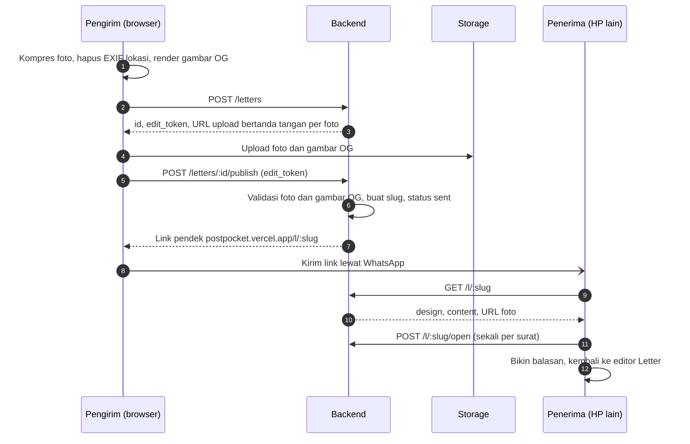

# Panduan Backend PostPocket

Untuk Bintang dan agent-nya. Baca [AGENTS.md](../AGENTS.md) dulu; detail produk lengkap ada di [PRD](prd/PRD-PostPocket.md).

> [!IMPORTANT]
> Rilis 1 cuma butuh server untuk **surat yang dikirim** (modul Letter). Pocket, TV, dan Booth jalan penuh di browser (IndexedDB) dan baru disinkronkan ke server di fase 2.

## Peranmu

Bintang memegang auth, database, storage foto, API surat dan share link, gambar OG untuk preview link, kompresi dan pembersihan file, rate limit, dan deploy backend.

Backend memakai Supabase (Postgres, Auth, Storage, Edge Functions); keputusan ini sudah final dan proyeknya sudah dibuat. Frontend di-deploy ke Vercel Hobby.

Area kode: `supabase/migrations/`, `supabase/functions/`, dan `docs/api/openapi.yaml`.

## Alur surat



## Keputusan yang menunggu

Catat jawabannya di PRD bagian Pertanyaan terbuka (centang dan tulis keputusannya) lewat PR.

Belum ada. Login sudah diputuskan (fase 2, Google OAuth), lihat [Rancangan skema fase 2](#rancangan-skema-fase-2).

## Keputusan yang sudah diambil

| Keputusan | Isi |
| --- | --- |
| Backend | **Supabase**, bukan stack sendiri. Kalau storage 1 GB tidak cukup, foto dipindah ke Cloudflare R2 dan database tetap di Supabase |
| Gambar OG | **Dirender browser** waktu "Buat link" dari kartu yang sama dengan yang dilihat pengirim (JPEG 1200×630, maksimal 300.000 byte; PNG juga diterima tapi dari foto hampir selalu melewati batas), lalu diunggah lewat URL bertanda tangan seperti foto. Backend hanya memvalidasi tipe, ukuran, dan dimensi saat publish, lalu mencatatnya sebagai baris `letter_assets` berjenis `og`. Kalau dirender di Edge Function, tampilan foil harus dibuat ulang di sana |
| Bucket `letter-assets` | **Publik untuk baca**, path acak tak tertebak per surat (`<letter_id>/<uuid>.<ext>`). Upload hanya lewat URL bertanda tangan dari `POST /letters`; tidak ada policy listing. Publik dipilih supaya crawler WhatsApp bisa mengambil gambar OG dan file bisa di-cache CDN (hemat egress) |
| Batas foto | Maksimal **4 foto per surat** (sesuai template kolase), maksimal **500 KB per foto** setelah dikompres, tipe JPEG atau WebP. Cover (gambar depan dari foto user) punya batas yang sama tapi **tidak dihitung** ke 4 foto. Gambar OG maksimal 300 KB |
| Masa berlaku surat | Surat (data, link, dan gambar OG) dihapus **30 hari setelah publish** |
| Masa berlaku foto | Foto dihapus **7 hari setelah surat pertama kali dibuka** (`opened_at`). Kalau tidak pernah dibuka, foto ikut terhapus bersama suratnya di hari ke-30. Kalau gambar depannya foto user, cover dan gambar OG ikut dihapus saat itu karena gambar OG memuat foto yang sama. Setelah dihapus, halaman penerima tetap menampilkan kartu dan teks dengan placeholder, dan memakai gambar OG bawaan |
| Rate limit | `POST /letters` maksimal **10 surat per jam per IP** untuk awal, dievaluasi dari pemakaian. Operator seluler di Indonesia banyak memakai CGNAT, jadi satu IP bisa dipakai banyak orang; kalau 429 mulai sering muncul, kuncinya digabung dengan penanda per perangkat |
| Repo | **Public**. Alasannya, Vercel Hobby memblokir deploy dari commit yang author-nya bukan pemilik akun di repo private. Sudah terbukti di PR #6: commit dari akun Bintang ter-deploy di proyek Vercel milik Kall |

Dengan batas di atas, storage 1 GB muat sekitar 500 surat penuh sekaligus. Karena foto hidup paling lama 7 hari setelah dibuka, yang perlu dipantau adalah jumlah surat aktif, bukan total surat.

## Batasan free tier

| Layanan | Batas yang berpengaruh | Akibatnya |
| --- | --- | --- |
| Supabase Free | Storage 1 GB, 2 proyek aktif | Ditahan oleh batas foto dan masa berlaku di atas. Satu proyek untuk produksi, satu untuk staging |
| Supabase Free | Egress 5 GB per bulan | Foto yang dibuka penerima ikut dihitung dan kemungkinan habis sebelum storage. Dengan 4 foto × 500 KB, cukup untuk sekitar 2.500 kali surat dibuka per bulan; pantau egress selama beta |
| Supabase Free | Proyek di-pause setelah 7 hari tanpa request | Selama pemakaian masih sepi, link surat bisa mati. Cron cleanup memanggil fungsi tiap jam lewat URL publik, ditambah ping harian dari luar: workflow `Ping produksi` (`.github/workflows/ping.yml`), yang juga gagal dan mengirim email kalau produksi mati |
| Vercel Hobby | Body fungsi sekitar 4,5 MB, durasi pendek | Foto dan gambar OG selalu diunggah langsung ke storage lewat URL bertanda tangan, tidak lewat fungsi Vercel |
| Vercel Hobby | Hanya untuk non-komersial | Kalau nanti ada monetisasi, pindah ke Pro atau host lain |
| Vercel Hobby | Custom event analitik dan cron terbatas | Event analitik disimpan di tabel Postgres ([Analitik](#analitik-dan-monitoring-error)); job pembersihan memakai `pg_cron` di Supabase |

## Pembersihan file

Job `pg_cron` `pembersihan-surat` jalan tiap jam di menit ke-7 dan menjalankan `public.run_cleanup()`. Fungsi SQL itu menghapus baris `rate_limit_hits` yang lebih tua dari 1 jam dan baris fase 2 berstatus hapus yang lebih tua dari 30 hari (momen hanya kalau berkasnya sudah tidak ada), lalu memanggil Edge Function `cleanup` lewat `pg_net`. Edge Function itu menghapus:

- draf yang tidak pernah di-publish setelah 24 jam, beserta filenya (diberi tenggang 10 menit supaya publish yang sedang berjalan tidak terpotong);
- foto surat yang `photos_expire_at`-nya sudah lewat (7 hari setelah dibuka), beserta cover dan gambar OG kalau gambar depannya foto user, lalu mengisi `photos_deleted_at`;
- surat yang sudah lewat 30 hari sejak publish, beserta foto dan gambar OG-nya;
- kotak bareng yang lewat `expires_at` (30 hari setelah `opens_at`), beserta semua titipan (termasuk draf) dan berkasnya;
- berkas di bucket `moments` yang tidak punya baris `moments` aktif (`orphan_moment_files()`): momennya sudah dihapus, atau user-nya sudah dihapus dan barisnya ikut terhapus cascade. Berkas selalu diunggah setelah barisnya ada (policy unggah), jadi berkas tanpa baris aktif pasti sampah;
- berkas di bucket `letter-assets` yang tidak punya baris `letter_assets` (`orphan_letter_files()`, migrasi `hardening`). URL upload berlaku 2 jam dan tidak bisa dicabut, jadi berkas yang diunggah setelah suratnya dihapus tidak punya baris lagi.

Satu putaran memproses paling banyak 1.000 surat per jenis; sisanya diambil putaran berikutnya. `GET /l/:slug` tidak menunggu job: surat jadi 404 begitu `expires_at` lewat, dan foto tidak dikembalikan lagi begitu `photos_expire_at` lewat. Jadi jeda sampai job jalan hanya memengaruhi kuota, tidak pernah terlihat penerima.

Fungsi `cleanup` menerima header `x-cleanup-token` (token acak di Vault, dibuat migrasi `cleanup_job`, tidak pernah ada di repo) atau `Authorization: Bearer <secret key>` untuk test dan pemanggilan manual. `run_cleanup()` membaca URL proyek dari secret Vault `project_url`. Secret ini diisi sekali per lingkungan, dan selama kosong job hanya membersihkan rate limit:

```sh
# Proyek Supabase (sudah diisi untuk produksi)
supabase db query --linked "select vault.create_secret('https://<ref>.supabase.co', 'project_url')"
# Stack lokal: Edge Functions dicapai dari container DB lewat Kong
docker exec supabase_db_postpocket psql -U postgres -c "select vault.create_secret('http://kong:8000', 'project_url')"
```

Hasil panggilan terakhir ada di `net._http_response` (disimpan 6 jam) dan log Edge Function `cleanup`.

File harus dihapus lewat Storage API (`storage.remove()`) di Edge Function. Menghapus baris `storage.objects` lewat SQL meninggalkan file yatim yang tetap memakan kuota ([Supabase: Delete Objects](https://supabase.com/docs/guides/storage/management/delete-objects)).

## Analitik dan monitoring error

Halaman `/privasi` sudah berjanji dua hal: fungsi server tidak mencatat alamat IP, dan tidak ada cookie pelacak atau analitik pihak ketiga. Rancangan di bawah menjaga dua janji itu. Kontrak API dan frontend tidak berubah.

### Event analitik

Tabel `letter_events` hanya berisi tiga kolom:

| Kolom | Isi |
| --- | --- |
| `kind` | `created`, `opened`, atau `replied` |
| `occurred_at` | Waktu kejadian, dibulatkan ke bawah ke jam penuh (UTC) |
| `after_hours` | Jam penuh sejak surat (untuk `replied`: surat yang dibalas) di-publish. Kosong untuk `created` |

Tabel ini tidak menyimpan `letter_id`, slug, IP, user agent, cookie, atau isi surat. Tidak ada kolom yang menunjuk ke surat. Waktunya sengaja dibulatkan ke jam: trigger jalan di transaksi yang sama, jadi `now()` yang presisi akan sama persis dengan `published_at` atau `opened_at` dan bisa di-join 1:1 ke suratnya. Setelah suratnya dihapus di hari ke-30, event tidak bisa dikaitkan lagi, tapi tetap ada. Akibatnya, analitiknya berupa jumlah per periode, bukan alur per surat. Misalnya: berapa surat dibuat minggu ini, berapa persen yang dibuka, dan berapa lama sampai dibuka.

Event dicatat trigger di tabel `letters`, dalam transaksi yang sama dengan perubahannya. Jadi Edge Functions tidak berubah, dan event tidak hilang kalau fungsi gagal di tengah jalan.

| Event | Kapan | Sumber |
| --- | --- | --- |
| `created` | Status draf jadi `sent` | `publish_letter()` |
| `replied` | Sama dengan `created`, untuk surat yang punya `reply_to_id` | `publish_letter()` |
| `opened` | `opened_at` pertama kali terisi | `open_letter()` (idempoten, jadi sekali per surat) |

"Dibuat" dan "dibalas" dihitung saat publish, bukan saat `POST /letters`. Draf yang tidak pernah dikirim terhapus setelah 24 jam dan tidak dihitung. Balasan juga dihitung sebagai surat dibuat.

Baris lebih tua dari 13 bulan dihapus `run_cleanup()`. Datanya dibaca lewat SQL di dashboard, misalnya view `letter_stats_weekly`: jumlah per jenis per minggu (WIB), plus median `after_hours`.

### Monitoring error

Untuk sekarang tidak ada layanan luar (Sentry dan sejenisnya), supaya tidak ada data yang keluar ke pihak ketiga dan `/privasi` tetap benar.

- Setiap respons 5xx dari keenam fungsi (`letters`, `l`, `boxes`, `k`, `account`, dan `cleanup`) dicatat ke tabel `function_errors`, dengan kolom:
  - `function`, `route` (pola, misalnya `/l/:slug`, bukan path aslinya);
  - `status`, `error_name` (misalnya `TypeError`, `PostgrestError`), `error_code` (kode PostgREST atau Postgres seperti `PGRST116` atau `57014`, atau status Storage);
  - `occurred_at`.

  Pesan error tidak disimpan. Error `fetch` di Deno menyertakan URL lengkap, termasuk filter PostgREST seperti `slug=eq.…`, dan error Postgres kadang menyertakan nilai input. Nama dan kode disaring dengan pola huruf, angka, dan garis bawah di fungsi dan sekali lagi di constraint tabel. Header, body, IP, slug, dan token tidak dicatat. Barisnya disimpan 30 hari, lalu dihapus `run_cleanup()`.
- Pencatatannya best effort lewat `EdgeRuntime.waitUntil()`. Respons 500 keluar tanpa menunggu insert, dan kalau insert-nya gagal (biasanya justru saat DB bermasalah), cukup ditulis ke log.
- Log Edge Function di dashboard Supabase menyimpan nama, kode, dan baris stack error (`logError()` di `_shared/errors.ts`), tanpa pesannya, dengan alasan yang sama. Baris stack menunjuk tempat error terjadi. Log itu dicatat penyedia, sesuai kalimat log teknis di `/privasi`.
- Hasil panggilan job pembersihan dicek dari `net._http_response`.
- View `function_errors_daily` merangkum error per fungsi, route, dan kode per hari (WIB). View ini dicek tiap hari bareng pemantauan kuota storage dan egress.
- 5xx dari gateway atau platform tidak lewat kode fungsi, jadi tidak masuk `function_errors`. Contohnya boot error, `WORKER_LIMIT`, dan timeout. Pengecekan harian tetap melihat Logs dan Invocations tiap fungsi di dashboard.

Error di browser (frontend) belum tercakup. Kalau nanti perlu, butuh endpoint baru, yang masuk kontrak dulu.

### Akses

Relasi baru di schema `public` otomatis dapat grant ke `anon` dan `authenticated`. View yang dibuat `postgres` juga jalan dengan hak pemiliknya, jadi RLS tabel di bawahnya dilewati. Karena itu:

- `letter_events` dan `function_errors` memakai RLS tanpa policy, dan hak `anon`/`authenticated` dicabut;
- `letter_stats_weekly` dan `function_errors_daily` dibuat `with (security_invoker = true)`, dan hak `anon`/`authenticated` juga dicabut;
- pgTAP memastikan `anon` dan `authenticated` tidak bisa `select` dari keempatnya.

Yang bisa membaca hanya secret key dan SQL di dashboard (SQL Editor), atau CLI yang di-link:

```sh
supabase db query --linked "select * from letter_stats_weekly order by week desc, kind"
supabase db query --linked "select * from function_errors_daily where day > current_date - 7 order by day desc"
```

## Checklist per sprint

Centang item di PR yang menyelesaikannya. Agent mulai dari item pertama yang belum dicentang. Per 22 Oktober 2026 semua item sudah dicentang; pekerjaan baru ditambahkan di sini lewat PR sebelum dikerjakan.

**Sprint 0 (minggu 1)**

- [x] Buat repo GitHub (dibuat Kall)
- [x] Buat proyek Supabase, lalu kirim URL dan anon key ke Kall lewat jalur privat, bukan lewat commit
- [x] Job CI untuk lint dan test backend: workflow `Backend` (lint skema, test pgTAP, lint `openapi.yaml`)
- [x] Migrasi `letters` dan `letter_assets` beserta RLS dan bucket `letter-assets`
- [x] `docs/api/openapi.yaml` untuk lima endpoint rilis 1, supaya Kall bisa jalan dengan mock
- [x] Putuskan bucket `letter-assets` publik atau bertanda tangan

**Sprint 1 (minggu 2–3)**

- [x] `POST /letters` dengan URL upload bertanda tangan
- [x] Rate limit pembuatan surat per IP untuk pengguna anonim
- [x] Hapus EXIF di sisi server sebagai lapis kedua (saat publish, lihat bagian Edge Functions)

**Sprint 2 (minggu 4–5)**

- [x] `POST /letters/:id/publish`: validasi isi serta foto dan gambar OG yang sudah diunggah, slug, status `sent`
- [x] Job pembersihan file (`pg_cron` + `pg_net` + Edge Function), lihat bagian Pembersihan file
- [x] `GET /l/:slug` dan `POST /l/:slug/open`
- [x] `DELETE /letters/:id`
- [x] `noindex` untuk surat: halaman `/l/:slug` memakai `robots: noindex` (Kall), respons API memakai `Cache-Control: no-store`
- [x] Gerbang rilis: link surat terbuka di HP lain tanpa login dan preview-nya tampil di WhatsApp, lolos 13 Oktober 2026 (hasil cek di [frontend.md](frontend.md#gerbang-sprint-2))

**Sprint 3 (minggu 6–7)**

- [x] Event analitik: surat dibuat, dibuka, dibalas ([Analitik](#analitik-dan-monitoring-error))
- [x] Monitoring error tanpa layanan luar (`function_errors`, plus log dashboard untuk error gateway)
- [x] Review keamanan semua endpoint ([hasil](#review-keamanan))

**Sprint 4 dan beta (minggu 8–10)**

- [x] Skema fase 2 (`profiles`, `pockets`, `moments`, `albums`) beserta RLS: [Rancangan skema fase 2](#rancangan-skema-fase-2), migrasi `phase2` dan test `phase2.test.sql`
- [x] Login Google: OAuth client dan provider di dashboard, dipasang bareng Kall 15 Oktober 2026, provider Email dimatikan 16 Oktober ([Login Google](#login-google)). Hapus akun (#62, #63) sudah dicek di produksi lewat akun tester dan UI
- [x] Edge Function `account` untuk `DELETE /account` (kontrak 0.4.0): hapus berkas `moments/<user_id>/…` lewat Storage API, lalu `auth.admin.deleteUser`; sesi dicek dengan `auth.getUser(token)`. Test integrasi `tests/account.test.ts`: tanpa token, token salah, dan akun yang sudah dihapus `401`, akun lain tidak tersentuh, berkas dan baris hilang
- [x] Lingkungan beta: tidak dibuat terpisah. Rilis 1.0 langsung memakai produksi (`postpocket.vercel.app` dan proyek Supabase di Sydney) sejak 16 Oktober 2026, dengan client OAuth Google berstatus In production dan ping harian `.github/workflows/ping.yml`
- [x] Selama beta: perbaiki bug, pantau kuota storage dan error. Dicek 22 Oktober 2026: `function_errors` kosong, ping harian lolos setiap hari sejak 17 Oktober, storage terpakai sekitar 3 MB, dan tidak ada issue terbuka. Pemantauan rutin tetap mengikuti [Monitoring error](#monitoring-error)

**Kotak bareng** (kontrak 0.3.0, [rancangan](#rancangan-kotak-bareng))

- [x] Review kontrak 0.3.0 (usulan Kall) dan putuskan angka di [Keputusan kotak bareng](#keputusan-kotak-bareng)
- [x] Migrasi `boxes`, kolom `letters.box_id` dan `letters.from_name`, beserta RLS, constraint, dan test pgTAP
- [x] `POST /letters` menerima `box` (ganti penjaga sementara `box_not_found` di `_shared/validate.ts`), publish memeriksa kotaknya, dan `GET /l/:slug`, `POST /l/:slug/open`, serta `replyTo` memperlakukan surat titipan sebagai tidak ada
- [x] Edge Function `boxes` (enam endpoint `/boxes/…`) dan `k` (`GET /k/:slug`, `POST /k/:slug/open`), preflight CORS di `_shared/http.ts` menerima `PATCH`, dan `_shared/errors.ts` mencatat error kedua fungsi itu
- [x] Job pembersihan: kotak lewat `expires_at` beserta titipannya, foto titipan 7 hari setelah kotak dibuka
- [x] Deploy, lalu kabari Kall untuk menyalakan `NUXT_PUBLIC_KOTAK_BARENG` di Vercel (menyala di produksi sejak 15 Oktober 2026)

**Rilis 1.0**

- [x] Audit keamanan backend sebelum rilis ([hasil](#audit-sebelum-rilis-10)): migrasi `hardening`, perbaikan fungsi, dan kontrak 0.4.1
- [x] Deploy hasil audit, 16 Oktober 2026: `supabase db push` (migrasi `hardening`), lalu `supabase functions deploy letters l boxes k cleanup account`. Dicek di produksi:
  - body `/boxes` 5 KB ditolak `400`;
  - `box.from` 90 KB divalidasi secepat body kontrol berukuran sama (sekitar 1 detik, termasuk unggah);
  - job `cleanup` melaporkan `letterFiles`;
  - `orphan_letter_files()` ditolak `42501` untuk publishable key;
  - `function_errors` kosong.
- [x] [Setelan dashboard](#setelan-dashboard): billing email organisasi untuk pemberitahuan kuota, dikonfirmasi 22 Oktober 2026

## Data model rilis 1

| Tabel | Kolom penting |
| --- | --- |
| `letters` | `id`, `slug`, `design` jsonb, `content` jsonb, `status`, `edit_token_hash`, `reply_to_id`, `created_at`, `draft_expires_at`, `published_at`, `expires_at`, `opened_at`, `photos_expire_at`, `photos_deleted_at` |
| `letter_assets` | `id`, `letter_id`, `storage_path`, `kind` (`photo`/`cover`/`og`), `key` (kunci foto di `content`, khusus `photo`), `mime`, `size`, `width`, `height`, `uploaded_at` |
| `rate_limit_hits` | `bucket`, `key` (HMAC dari IP, bukan IP mentah), `created_at`. Diisi `take_rate_limit()` |
| `letter_events` | `kind` (`created`/`opened`/`replied`, plus `box_created`/`box_letter`/`box_opened` untuk kotak bareng), `occurred_at` (dibulatkan ke jam), `after_hours`. Diisi trigger `letters_record_event` dan `boxes_record_event` |
| `function_errors` | `function`, `route` (pola), `status`, `error_name`, `error_code`, `occurred_at`. Diisi Edge Functions lewat `_shared/errors.ts` |
| `boxes` | Kotak bareng (kontrak 0.3.0), lihat [Rancangan kotak bareng](#rancangan-kotak-bareng). `letters` mendapat `box_id` dan `from_name` untuk surat titipan |

- `slug` unik, minimal 10 karakter acak, dibuat saat publish.
- Surat tidak terikat ke akun, juga setelah login Google ada: pengirim memegang edit token. Kolom `owner_id` yang dulu disiapkan untuk itu dibuang di migrasi `hardening` karena tidak pernah diisi.
- `design` menyimpan **id preset** (gambar depan, bentuk, mode foil, bingkai foil, warna foil, kertas, template), bukan nilai warnanya, supaya preset bisa dipoles tanpa merusak surat lama. Id-nya berasal dari `packages/presets/*.json` milik Kall.
- `content` menyimpan elemen kanvas (teks, foto, stiker) beserta posisi, lebar, dan rotasi. Bentuknya ada di [`docs/api/openapi.yaml`](api/openapi.yaml) (`LetterContent`) dan sama dengan `packages/presets/src/letter-content.ts`.
- `letter_assets` dibuat saat `POST /letters` dari metadata yang dikirim frontend. Stiker tidak diunggah karena berasal dari preset.
- Cover dan gambar OG dicatat sebagai baris `letter_assets` berjenis `cover` dan `og`, bukan kolom di `letters`, supaya semua berkas dibersihkan lewat satu tabel.
- `letter_assets.letter_id` memakai `on delete restrict`: berkas di Storage dihapus lewat Storage API dulu, baru barisnya, lalu suratnya. Urutan lain gagal di database, jadi tidak ada file yatim.
- Batas berkas ditegakkan juga di database: foto dan cover JPEG/WebP ≤ 500.000 byte dan ≤ 2048 px, OG JPEG/PNG 1200×630 ≤ 300.000 byte, maksimal 4 foto per surat, satu cover dan satu OG.
- Kedua tabel memakai RLS tanpa policy dan hak `anon`/`authenticated` dicabut. Semua akses lewat Edge Functions dengan secret key. Tabel fase 2 (`profiles`, `moments`, `pockets`, `albums`) beda: dibuka untuk `authenticated` dengan RLS per user, lihat [Rancangan skema fase 2](#rancangan-skema-fase-2).
- Skema lengkapnya ada di `supabase/migrations/`, ujinya di `supabase/tests/database/`.
- Fungsi database untuk Edge Functions: `create_letter()` (draf dan baris berkas dalam satu transaksi), `publish_letter()`, `open_letter()` (idempoten), `take_rate_limit()`, `create_box()`, `update_box()`, `open_box()` (kotak bareng), serta `cleanup_token_valid()`, `run_cleanup()`, `orphan_moment_files()`, dan `orphan_letter_files()` untuk job pembersihan. Trigger `record_letter_event()` mengisi `letter_events`. Semuanya hanya bisa dijalankan secret key.
- `edit_token_hash`: server hanya menyimpan hash. Token mentahnya dikembalikan sekali ke browser pengirim, supaya pengirim bisa menghapus suratnya tanpa akun.
- `reply_to_id` menunjuk surat yang dibalas (jalur viral "Bikin balasan").
- `status` bernilai `draft` atau `sent`. `opened_at` diisi sekali saat surat pertama kali dibuka.
- `expires_at` = `published_at` + 30 hari. `photos_deleted_at` diisi job pembersihan, supaya `GET /l/:slug` tahu harus menampilkan placeholder foto.

## Rancangan skema fase 2

Disetujui Kall di #47. Migrasinya `supabase/migrations/20261014053904_phase2.sql`, ujinya `supabase/tests/database/phase2.test.sql`. Sumbernya tabel fase 2 di PRD bagian Arsitektur, disesuaikan dengan data Pocket yang sudah jalan di browser (`apps/web/app/utils/memories.ts`), supaya sinkron nanti cuma memindahkan baris, bukan mengubah bentuk data.

**Prinsip**

- IndexedDB tetap sumber utama dan tetap jalan offline. Server adalah cadangan dan jalur sinkron antar perangkat, aktif hanya setelah login (Google OAuth).
- CRUD lewat klien Supabase langsung (`supabase-js` dengan sesi user), tanpa Edge Function. RLS di setiap tabel: user hanya bisa membaca dan menulis baris dengan `owner_id = auth.uid()`.
- Id momen dan album dibuat di browser (`crypto.randomUUID()`), supaya bisa dibuat offline dan dikirim ulang dengan `upsert` tanpa jadi ganda. Kantong tidak punya id: kuncinya `(owner_id, day)`, sama seperti `PocketDay` yang dikunci per hari, jadi dua HP yang membuat kantong hari yang sama secara offline langsung bertemu di satu baris.
- Hapus di satu perangkat harus sampai ke perangkat lain, jadi baris tidak langsung dihapus: `deleted_at` diisi. Baris berstatus hapus dibuang job pembersihan setelah 30 hari.
- `updated_at` diisi trigger server, bukan browser, supaya jam HP yang salah tidak merusak urutan sinkron. Konflik diselesaikan "tulisan terakhir menang" per baris.

**Tabel**

| Tabel | Kolom | Beda dari PRD |
| --- | --- | --- |
| `profiles` | `id` (= `auth.users.id`), `display_name` (≤ 40 karakter), `created_at` | Dibuat trigger saat user mendaftar |
| `moments` | `id`, `owner_id`, `day` (date), `taken_at`, `source` (`upload`/`booth`), `width`, `height`, `mime`, `size`, `created_at`, `updated_at`, `deleted_at` | `day` menggantikan `pocket_id`, sama seperti `Moment.day` di browser: momen bisa ada sebelum kantongnya disimpan. `storage_path` tidak disimpan karena selalu `<owner_id>/<id>.<ext>` |
| `pockets` | `owner_id` + `day` (primary key), `packet`, `sticker`, `frame`, `frame_color`, `moment_ids` (uuid[], urutan di kantong, maksimal 500), `saved_at`, `updated_at`, `deleted_at` | Tanpa `id`. Nama kolom mengikuti `PocketDay`. Urutan momen disimpan sebagai array |
| `albums` | `id`, `owner_id`, `title` (≤ 40), `emoji`, `color`, `moment_ids` (uuid[], urutan di CD, maksimal 500), `created_at`, `updated_at`, `deleted_at` | Hanya album buatan user. Album per bulan dihitung browser dari `moments.day`, jadi `kind` dan `month` tidak perlu. `album_moments` diganti `moment_ids` |

- `packet`, `sticker`, `frame`, dan `frame_color` menyimpan id preset (atau `#rrggbb` untuk warna custom), sama seperti `design` di `letters`. Database hanya mengecek bentuknya (huruf, angka, `-`, maksimal 40 karakter), bukan isi daftar preset.
- `moment_ids` sebagai array, bukan tabel `album_moments`, karena satu kantong atau album selalu ditulis utuh, sehingga sinkronnya satu baris. Id momen milik user lain di array tidak berbahaya: RLS tetap menyembunyikan momennya. Kalau nanti butuh query "momen ini ada di album mana", baru dipecah jadi tabel.
- `owner_id` punya `default auth.uid()` dan `references auth.users on delete cascade`, jadi hapus akun menghapus semua barisnya. Berkas di Storage tetap harus dihapus dulu lewat Storage API (lihat `letter_assets`), jadi hapus akun lewat Edge Function, bukan langsung dari browser.
- Hak `anon` dicabut dari semua tabel ini. `authenticated` hanya dapat `select`, `insert`, dan `update`, tanpa `delete`: hapus dari browser selalu lewat `deleted_at`.

**Kuota**

- Maksimal **100 momen aktif per user** (sekitar 50 MB). Trigger di `moments` menolak insert, atau update yang mengosongkan `deleted_at`, kalau user sudah punya 100 momen dengan `deleted_at is null`.
- Sejak migrasi `hardening`, ada juga batas baris per user, termasuk baris berstatus hapus: **1.500 kantong, 200 album, dan 1.000 baris momen**. Tanpa batas ini satu akun bisa mengisi database 500 MB lewat upsert biasa, misalnya ribuan album berisi 500 UUID acak atau momen yang dikirim sudah berstatus hapus. Hanya baris baru yang dihitung, jadi upsert baris yang sudah ada tetap lolos di batas. Ditolak dengan kode `23514` dan pesan `kuota … penuh`, yang di frontend jadi status "Cadangan … penuh" di kartu Cadangan.
- Kuota ini hanya berarti kalau setiap berkas punya baris. Karena itu policy unggah di bucket `moments` mensyaratkan baris `moments` milik user dengan `id` sama dengan nama berkas dan `deleted_at is null` (dicatat Kall). Satu baris, satu berkas: tanpa policy update, berkasnya juga tidak bisa ditimpa.
- Momen yang dihapus berkasnya dihapus browser saat itu juga (policy hapus), dan job pembersihan tiap jam menghapus berkas yang masih tertinggal tanpa baris aktif (lihat [Pembersihan file](#pembersihan-file)). Jadi hapus lalu tambah lagi hanya bisa menumpuk berkas paling lama sejam.
- Momen yang dipulihkan (`deleted_at` dikosongkan) setelah job menghapus berkasnya tetap aktif tanpa berkas. Browser yang memulihkan momen harus mengunggah ulang fotonya; policy unggah menerimanya karena barisnya aktif lagi.
- Storage menjawab `400` (bukan `403`) kalau unggah ditolak policy, dengan pesan `new row violates row-level security policy`.

**Sinkron (bagian frontend, dicatat di sini supaya skemanya tidak salah dipakai)**

- Tarik perubahan pakai jendela tumpang tindih: `updated_at > sinkron_terakhir - 5 menit`. `updated_at = now()` adalah waktu mulai transaksi, jadi transaksi yang commit belakangan bisa punya `updated_at` lebih kecil dari titik sinkron terakhir. Penerapan di browser harus idempoten, karena baris yang sama bisa datang dua kali.
- "Tulisan terakhir menang" per baris berarti HP yang lama offline bisa menimpa urutan `moment_ids` yang lebih baru. Di kantong, browser menempelkan lagi momen dengan `day` itu yang tidak ada di array, jadi foto tidak hilang dari kantong. Di album CD, tambahan dari HP lain bisa hilang. Diterima untuk beta.
- Id lokal momen dan album sudah UUID sejak #48. Data lama (`m`/`a` + 6 karakter) diganti saat dimuat, termasuk di `PocketDay.moments` dan `Album.moments`, jadi sinkron pertama tidak perlu mengganti id. Fotonya tidak dipindah: momen lama menyimpan kunci fotonya di `Moment.photoKey`. Kolom ini hanya ada di perangkat itu, tidak ikut ke server.
- Yang naik ke bucket adalah versi kompres ≤ 500 KB, sama seperti foto surat. Foto lokal (JPEG 2048 px, kualitas 0,86) sering lebih besar, jadi HP lain mendapat versi kompresnya.

**Storage**

- Bucket `moments`: privat, 500 KB per berkas, JPEG atau WebP, path `<owner_id>/<moment_id>.<ext>`.
- Policy untuk `authenticated`: baca dan hapus kalau folder pertamanya `auth.uid()`; unggah kalau folder pertamanya `auth.uid()` dan ada baris `moments` yang cocok (lihat Kuota). Tidak ada policy update dan tidak ada policy untuk `anon`.
- Foto ditampilkan lewat signed URL berumur pendek (`createSignedUrls`, satu panggilan per banyak foto).
- `security.test.sql` disesuaikan: policy storage untuk `authenticated` hanya boleh ada di bucket `moments` dan wajib memeriksa `auth.uid()`. Untuk `anon` dan `public` tetap tidak boleh ada. Test RLS baru wajib mencoba unggah tanpa baris `moments`, ke folder user lain, dan melewati 100 momen.

**Keputusan (diambil bareng Kall, 14 Oktober 2026)**

1. **Login: Google OAuth dulu.** Tidak perlu mengirim email. Magic link menyusul kalau ada yang minta, dengan SMTP sendiri, karena SMTP bawaan Supabase hanya mengirim beberapa email per jam dan hanya ke anggota tim proyek.
2. **Kuota: 100 momen per user selama beta.** Sebelum dibuka untuk umum, bandingkan Supabase Pro dengan Cloudflare R2. R2 lebih murah, tapi berada di luar RLS Supabase, jadi butuh Edge Function untuk signed URL unggah dan baca.
3. **Masuk produksi begitu merge.** Tabelnya terkunci RLS dan belum dipakai, dan `main` tetap sama dengan produksi. Kalau ditahan, `supabase db push` untuk hotfix surat berikutnya ikut menerapkan migrasi fase 2 juga.

## Login Google

Login fase 2 hanya lewat Google (keputusan #47). Kall membuat OAuth client di Google Cloud dan menempelkan client secret sendiri di dashboard Supabase, setelah diundang Bintang ke organisasi Supabase. Jadi secret-nya tidak pernah pindah tangan, dan tidak pernah lewat chat, commit, atau PR.

**1. Google Cloud (Google Auth Platform), oleh Kall**

- Branding: nama aplikasi PostPocket, email dukungan, domain `postpocket.vercel.app`, link ke `/privasi`.
- Audience: External, dipublikasikan (In production) sejak 16 Oktober 2026, jadi akun Google mana pun bisa masuk tanpa daftar tester. Scope hanya `openid`, `email`, `profile`, jadi tidak perlu verifikasi Google; logo tidak dipasang karena logo butuh verifikasi brand.
- Client: Web application.
  - Authorized JavaScript origins: `https://postpocket.vercel.app`.
  - Authorized redirect URI: `https://rmyfkdtqcltawmssollb.supabase.co/auth/v1/callback`. Untuk stack lokal tambahkan `http://127.0.0.1:54321/auth/v1/callback`.

**2. Dashboard Supabase (Authentication)**

Bintang mengundang email Kall ke organisasi Supabase dulu (Organization → Team), lalu:

- Sign In / Providers → Google: aktifkan, isi Client ID dan Client Secret (Kall).
- Sign In / Providers → Email: matikan provider Email ("Enable Email provider"). Jangan pakai "Allow new users to sign up" di pengaturan umum, karena itu ikut menutup pendaftaran lewat Google. Di produksi provider Email sudah dimatikan sejak 16 Oktober 2026 (`/auth/v1/settings`: `email: false`, `google: true`), karena PostPocket hanya memakai tombol Google. Akibatnya tes ke produksi tidak bisa lagi memakai akun email dan password; tes yang butuh login di produksi lewat akun Google di UI.
- URL Configuration: Site URL `https://postpocket.vercel.app`, Redirect URLs `https://postpocket.vercel.app/**`. Preview Vercel dan localhost tidak didaftarkan, sama seperti CORS: REST Supabase menerima origin mana pun, jadi redirect ke localhost membuat `pnpm dev` bisa login dan menulis tabel fase 2 di produksi. Login saat development lewat stack lokal, yang Site URL-nya sudah `http://localhost:3000` di `config.toml` dan callback-nya `http://127.0.0.1:54321/auth/v1/callback` (sudah didaftarkan di Google).

**3. Cek setelah setup**

```sh
curl -s https://rmyfkdtqcltawmssollb.supabase.co/auth/v1/settings -H "apikey: <publishable key>"
```

Hasilnya harus `external.google: true` dan `external.email: false`.

**Lokal.** `supabase/config.toml` sudah mengaktifkan Google dengan client ID dan secret dari env (`SUPABASE_AUTH_EXTERNAL_GOOGLE_CLIENT_ID`, `SUPABASE_AUTH_EXTERNAL_GOOGLE_SECRET` di `supabase/.env`, yang di-ignore git). Tanpa env itu stack tetap jalan, hanya tombol Google yang gagal. Provider email tetap nyala di lokal, karena test integrasi membuat user lewat `auth.admin.createUser` lalu login dengan password; `[auth.email] enable_signup = false` mematikan provider-nya, bukan cuma pendaftaran.

**Data dari Google.** Supabase menyimpan nama, email, dan foto profil Google di `auth.users` (`raw_user_meta_data`). `profiles.display_name` sengaja tidak diisi dari situ. `/privasi` perlu menjelaskan ini sebelum login dibuka (checklist Kall).

## Endpoint rilis 1

Detail request, respons, dan kode error ada di [`docs/api/openapi.yaml`](api/openapi.yaml). Semua endpoint dilayani dua Edge Function: `letters` (`/letters/…`) dan `l` (`/l/…`), dengan `verify_jwt` mati karena publishable key bukan JWT. Semua request membawa header `apikey`.

| Method | Path | Fungsi | Auth |
| --- | --- | --- | --- |
| POST | `/letters` | Buat draf, kembalikan `id`, `edit_token`, dan URL upload bertanda tangan untuk tiap foto (maksimal 4) dan gambar OG | Anonim boleh, kena rate limit |
| POST | `/letters/:id/publish` | Validasi isi serta foto dan gambar OG yang sudah diunggah, buat `slug`, ubah status jadi `sent` | Header `X-Edit-Token` |
| GET | `/l/:slug` | Ambil surat untuk halaman penerima (design, content, URL foto) | Publik |
| POST | `/l/:slug/open` | Catat waktu pertama kali dibuka | Publik, sekali per surat |
| DELETE | `/letters/:id` | Hapus surat dan fotonya | Header `X-Edit-Token` (pemilik akun di fase 2) |

## Edge Functions

Enam fungsi di `supabase/functions/`, semuanya dengan `verify_jwt = false`:

| Fungsi | Endpoint |
| --- | --- |
| `letters` | `POST /letters`, `POST /letters/{id}/publish`, `DELETE /letters/{id}` |
| `l` | `GET /l/{slug}`, `POST /l/{slug}/open` |
| `boxes` | `POST /boxes`, `GET`/`PATCH`/`DELETE /boxes/{id}`, `DELETE /boxes/{id}/letters/{letterId}`, `GET /boxes/invite/{invite}` |
| `k` | `GET /k/{slug}`, `POST /k/{slug}/open` |
| `account` | `DELETE /account` (hapus akun dan cadangan Pocket, kontrak 0.4.0) |
| `cleanup` | Job pembersihan, bukan bagian kontrak (lihat bagian Pembersihan file) |

Kode bersama ada di `_shared/`:

- `http.ts`: CORS sesuai kontrak, cek header `apikey` (harus publishable key proyek), bentuk error, dan body JSON dengan batas ukuran (100 KB untuk surat, 4 KB untuk kotak).
- `validate.ts`: body `POST /letters` dan `/boxes` dicek dengan skema dari kontrak (`_shared/openapi.json`, hasil `scripts/bundle-contract.sh`), lalu aturan isi dicek dengan preset dan `contentLimits` dari `packages/presets`, sama seperti mock frontend.
- `image.ts`: membaca tipe dan dimensi dari isi berkas, lalu hanya menyimpan bagian yang membentuk gambar, tanpa kompres ulang. EXIF, XMP, IPTC, MPF, C2PA, komentar, dan data sesudah EOI (gambar kedua, video Motion Photo) dibuang; profil warna ICC tetap.
- `files.ts`: hapus berkas lewat Storage API dulu, baru barisnya. Dipakai `DELETE /letters/{id}`, kotak bareng, dan job pembersihan.
- `errors.ts`: mencatat error 5xx ke `function_errors` (pola route, nama, dan kode saja), best effort lewat `EdgeRuntime.waitUntil()`, dan `logError()` menulis error ke log tanpa pesannya.
- `db.ts`: klien secret key, bentuk baris tabel, dan aturan bersama seperti `photosGone()`. Secret key diambil dari env yang disediakan Supabase (`SUPABASE_SECRET_KEYS`), jadi tidak perlu `secrets set`.
- `rate-limit.ts`: rate limit per IP lewat `take_rate_limit()`, dipakai `letters` dan `boxes`.
- `box.ts` dan `token.ts`: bentuk respons kotak bareng, serta edit token, slug, dan kunci rate limit.

Yang terjadi saat publish: setiap berkas diunduh dari Storage, ukurannya harus sama persis dengan metadata, tipe dan dimensinya dibaca dari isi berkas (bukan dari header). Kalau ada metadata yang tersisa atau content-type dari browser salah, berkasnya ditulis ulang tanpa metadata. Baru setelah itu `slug` dibuat dan status jadi `sent`.

Rate limit memakai IP dari `cf-connecting-ip`. Di proyek Supabase request lewat Cloudflare, yang mengisi header itu dengan IP asli dan menolak request yang mengirimnya sendiri; `x-forwarded-for` dari klien juga ditimpa (dicek langsung di proyek, Oktober 2026). IPv6 dihitung per /64.

```sh
# Stack lokal lengkap (DB, Storage, Edge Functions)
supabase start -x studio,imgproxy,mailpit,realtime,logflare,vector,supavisor,postgres-meta

# Dari supabase/functions
deno test tests/unit.test.ts
API_URL=http://127.0.0.1:54321 PUBLISHABLE_KEY=<dari supabase status> deno test -A tests/api.test.ts
# Job pembersihan, hanya stack lokal (memundurkan waktu di database)
API_URL=… PUBLISHABLE_KEY=… SECRET_KEY=<dari supabase status> deno test -A tests/cleanup.test.ts
API_URL=… PUBLISHABLE_KEY=… SECRET_KEY=<dari supabase status> deno test -A tests/boxes.test.ts
API_URL=… PUBLISHABLE_KEY=… SECRET_KEY=<dari supabase status> deno test -A tests/account.test.ts

# Setelah kontrak berubah
scripts/bundle-contract.sh

# Deploy (setelah migrasi baru di-push dengan supabase db push)
supabase functions deploy letters l boxes k cleanup account
```

Di stack lokal, Kong menimpa header CORS dengan `*`, jadi test CORS di `api.test.ts` hanya jalan kalau `API_URL` menunjuk proyek Supabase asli.

## Storage

- `letter-assets`: publik untuk baca, path acak tak tertebak per surat. Upload hanya lewat URL bertanda tangan; tidak ada policy listing.
- `moments` (fase 2): privat, hanya pemilik.

## Keamanan dan privasi

- Data lokasi EXIF dihapus di browser sebelum upload (Kall) dan di server sebagai lapis kedua (Bintang).
- Slug acak minimal 10 karakter supaya surat tidak bisa ditebak.
- `edit_token` disimpan di browser pengirim; server cuma menyimpan hash-nya.
- Rate limit pembuatan surat per IP untuk pengguna anonim.
- Surat pribadi tidak boleh masuk mesin pencari (`noindex`).
- Secret seperti service role key tidak pernah di-commit.

### Review keamanan

Review semua endpoint dan akses langsung ke Supabase, Oktober 2026 (Sprint 3). Diuji ke produksi dengan publishable key, kecuali yang ditandai lokal.

| Yang dicek | Hasil |
| --- | --- |
| REST `/rest/v1` ke `letters`, `letter_assets`, `rate_limit_hits`, `letter_events`, `function_errors`, dan kedua view | Ditolak `42501`. Insert juga ditolak (dicek Kall) |
| RPC ke semua fungsi di `public` (`create_letter`, `publish_letter`, `open_letter`, `take_rate_limit`, `run_cleanup`, `cleanup_token_valid`) | Ditolak `42501`. Tidak ada fungsi di `public` yang bisa dijalankan `anon` atau `authenticated` |
| GraphQL `/graphql/v1` | `pg_graphql` tidak aktif |
| Storage `letter-assets` | Listing kosong, termasuk untuk folder yang ada isinya (dicek Kall). Upload langsung ditolak RLS. Bucket membatasi 500 KB dan hanya JPEG/WebP/PNG |
| Menimpa berkas lewat `signedUrl` setelah publish (lokal) | Ditolak `409 KeyAlreadyExists`, juga dengan `x-upsert: true`, karena URL-nya dibuat tanpa upsert. Jadi berkas yang sudah dicek dan dibersihkan saat publish tidak bisa diganti |
| `X-Edit-Token` | 32 byte acak, server hanya menyimpan SHA-256-nya dan membandingkan tanpa bocor lewat waktu |
| Slug | 10 karakter base62 acak (sekitar 8 × 10¹⁷ kemungkinan), jadi tidak bisa ditebak walau `GET /l/:slug` tanpa rate limit |
| Fungsi `cleanup` | Tanpa token, dengan token salah, atau dengan publishable key: `401` |

Yang diperbaiki di review ini:

- CORS tidak lagi menerima `http://localhost:3000` di produksi (kontrak 0.2.3). Stack lokal tidak terpengaruh, karena gateway-nya menjawab `*`.
- CORS juga tidak lagi menerima preview Vercel (dicatat Kall). Nama `<proyek>.vercel.app` bisa didaftarkan siapa saja, jadi proyek bernama `postpocket-x-haikalfaruqs-projects` cocok dengan pola preview dan halamannya bisa memakai browser pengunjung untuk membuat surat dari banyak IP. Preview cukup memakai mock API.
- Body `POST /letters` dibaca bertahap dan dihentikan begitu lewat 100 KB, juga kalau `Content-Length` sudah lewat batas. Sebelumnya body dibaca utuh ke memori dulu, baru dicek.
- Semua respons JSON membawa `X-Content-Type-Options: nosniff`.
- Test pgTAP `security.test.sql` menjaga semua aturan akses di atas. Migrasi baru yang lupa `revoke`, lupa RLS, atau membuat view tanpa `security_invoker` akan gagal di CI. Sejak fase 2, test ini juga mendaftar persis hak `authenticated` (select, insert, update di tabel fase 2, tanpa delete) dan hanya menerima policy storage untuk `authenticated` di bucket `moments` yang memeriksa `auth.uid()`.

Risiko yang diterima untuk rilis 1:

- `POST /letters/:id/publish` dan `DELETE` tidak dibatasi rate limit. Keduanya butuh edit token milik draf sendiri, dan pembuatan draf sudah dibatasi 10 per jam per IP. Publish yang gagal berulang tetap mengunduh berkasnya lagi (paling banyak 6 × 500 KB). Kalau terlihat di `function_errors` atau egress, tambahkan rate limit per surat.
- `GET /l/:slug` dan `open` tidak dibatasi. Slug tidak bisa ditebak, dan `open` idempoten.
- Rate limit per IP lemah di CGNAT (lihat Keputusan yang sudah diambil).
- Berkas di bucket publik bisa dibuka siapa pun yang tahu URL lengkapnya. Itu memang dibutuhkan crawler WhatsApp, dan path-nya memuat dua UUID acak.

### Audit sebelum rilis 1.0

Audit ulang semua fungsi, migrasi, workflow, dan `config.toml`, 16 Oktober 2026. Tidak ada celah akses (IDOR, token bocor, RLS bolong) dan tidak ada rahasia di repo maupun di riwayat git. Yang diperbaiki di migrasi `hardening`, fungsi, dan kontrak 0.4.1 (di-deploy ke produksi 16 Oktober 2026):

| Temuan | Perbaikan |
| --- | --- |
| Satu akun Google bisa mengisi database 500 MB: kantong, album, dan baris momen yang dikirim sudah berstatus hapus tidak dibatasi | Batas baris per user (lihat [Kuota](#rancangan-skema-fase-2)), dan frontend menampilkan "Cadangan … penuh" |
| Pola `BoxText` mundur-maju kuadratik: body 100 KB berisi satu baris panjang memakan sekitar 5 detik CPU per request, sebelum rate limit sempat menolak | Pola linear dengan lookahead, plus batas body 4 KB untuk `/boxes`. Unit test memastikan teks 99,9 KB divalidasi dalam hitungan milidetik |
| URL upload yang masih berlaku bisa dipakai setelah suratnya dihapus, meninggalkan berkas publik tanpa baris yang tidak pernah dibersihkan | `orphan_letter_files()` dan langkah `letterFiles` di job `cleanup` |
| Error dari fungsi `account` selalu ditolak check constraint `function_errors` | Constraint menerima `account` dan `/account` |
| Log fungsi menulis error utuh, termasuk "Failing row contains (…)" dan URL berisi slug | `logError()` hanya menulis nama, kode, dan baris stack |
| Pembersih metadata lapis kedua melewatkan MPF, C2PA (APP11 JPEG, chunk `caBX` PNG), dan data sesudah EOI | `image.ts` hanya menyimpan bagian yang membentuk gambar |
| `letters.owner_id` tidak pernah diisi | Dibuang |
| CI hanya mengecek tipe tiga fungsi dan tidak memindai rahasia | `deno check */index.ts`, dan workflow `Web` menjalankan `scripts/check-secrets.sh` ke semua berkas |

Yang belum dikerjakan, sengaja dibiarkan sebagai risiko yang diterima (diputuskan 22 Oktober 2026, ditinjau lagi sebelum promosi besar):

- Batas tingkat proyek (semua IP digabung) untuk surat, kotak, dan cadangan. Rate limit sekarang per IP dan per user, jadi banyak IP atau banyak akun masih bisa menghabiskan storage dan egress. Putuskan bareng soal Supabase Pro atau Cloudflare R2 sebelum promosi besar.
- Belum ada alarm kalau job pembersihan berhenti. Sementara itu, cek `net._http_response` dan `function_errors_daily`.
- GitHub Actions dipasang lewat tag, bukan hash commit. Dampaknya kecil: semua workflow hanya punya hak baca dan tidak memakai secret.
- Tabel `profiles` tidak dipakai aplikasi, tapi barisnya dibuat trigger di `auth.users`. Membuang trigger di tabel milik Supabase Auth butuh hak pemilik tabel, jadi dibiarkan.

### Setelan dashboard

`supabase/config.toml` hanya untuk stack lokal dan CI, dan sengaja berbeda dari produksi (login email dengan password 6 karakter untuk test). Jangan jalankan `supabase config push` ke produksi. Setelan produksi diatur di dashboard:

- [x] Authentication: hanya provider Google, provider Email mati ([Login Google](#login-google)).
- [x] Audit log Auth (email dan IP) tidak ditulis ke database: `auth.audit_log_entries` kosong saat dicek 16 Oktober 2026, sedangkan `auth.users` berisi. Jadi catatan login hanya ada di log penyedia, sesuai kalimat log teknis di `/privasi`. Kalau suatu saat tabel itu terisi, matikan Authentication → Audit Logs → "Write audit logs to the database", lalu kosongkan isinya lewat SQL Editor.
- [x] Realtime tidak dipakai, jadi "Allow public access to channels" dimatikan (Realtime → Settings, 16 Oktober 2026). Join ke channel publik dengan publishable key sekarang ditolak `PrivateOnly`. Peringatan "No Realtime RLS policies found" di halaman itu sengaja dibiarkan: tanpa policy di `realtime.messages`, channel privat pun tidak menerima pesan.
- [x] Pemakaian: paket Free tidak punya setelan peringatan sendiri. Begitu kuota terlewati, Supabase mengirim email ke billing email organisasi lalu memberi masa tenggang, jadi Owner memastikan billing email di Organization Settings → Billing memang dibaca (dikonfirmasi 22 Oktober 2026). Angka pemakaian ada di panel "Free plan usage" halaman organisasi; per 16 Oktober 2026: database 28 dari 500 MB, egress 0,01 dari 5 GB, storage 0 dari 1 GB, 4 user aktif bulanan.

## Yang dibutuhkan frontend

- `docs/api/openapi.yaml` lebih dulu, supaya Kall bisa membangun UI dengan mock.
- URL proyek dan anon key untuk `.env` (lewat jalur privat).
- CORS untuk domain frontend produksi saja. Preview deploy Vercel dan `pnpm dev` memakai mock API atau stack lokal (kontrak 0.2.3).
- Gambar OG yang dirender browser saat "Buat link" dan bisa diambil crawler WhatsApp tanpa login, lewat URL publik yang dikembalikan `GET /l/:slug`.
- Proyek Supabase (DB dan Storage) ada di Sydney (`ap-southeast-2`). Edge Functions secara bawaan jalan di region terdekat dengan pemanggil, yaitu Singapura (`ap-southeast-1`) untuk pengguna di Indonesia dan fungsi Vercel `sin1`, lalu setiap query bolak-balik ke Sydney. Karena itu frontend memanggil fungsi dengan `?forceFunctionRegion=ap-southeast-2` (kontrak 0.2.2): `GET /l/:slug` turun dari median sekitar 1,0 detik ke 0,55 detik (diukur Kall dan Bintang, Oktober 2026). Region yang dipaksa tidak dialihkan kalau Sydney down, tapi DB-nya juga di sana.
- Fungsi Vercel diset ke `sin1` supaya SSR `/l/:slug` tidak bolak-balik ke US.

## Rancangan kotak bareng

Usulan Kall (14 Oktober 2026), disetujui Bintang di #56 dan diterapkan di migrasi `boxes`, fungsi `boxes` dan `k`, serta `letters`. Kontraknya `docs/api/openapi.yaml` 0.3.0; frontend sudah jalan di atas mock yang mengikuti kontrak itu (`apps/web/server/utils/mock-boxes.ts`, diuji `e2e/mock-api.spec.ts` dan `e2e/kotak-bareng.spec.ts`), dan disembunyikan di produksi sampai fungsinya ter-deploy. Alurnya di [PRD Modul 4](prd/PRD-PostPocket.md#modul-4-kotak-surat).

**Prinsip**

- Surat titipan adalah surat biasa di `letters` dengan `box_id`, jadi validasi isi, unggah lewat URL bertanda tangan, pembersihan EXIF saat publish, dan pembersihan berkas tetap satu jalur.
- Ada tiga kunci yang berbeda: `slug` kotak (link buka, untuk penerima), `invite` (link titip, untuk teman-teman), dan `edit_token` (pembuat kotak, hanya hash di server). Pemegang `invite` hanya bisa menambah surat dan melihat jumlahnya, tidak pernah isinya.
- Semua waktu dibanding dengan jam server (`openable`, `closed`), bukan jam HP.

**Tabel**

| Tabel | Kolom | Catatan |
| --- | --- | --- |
| `boxes` | `id` (uuid), `slug` (10 base62, unik), `invite` (12 base62, unik), `edit_token_hash`, `title`, `recipient` (`to` di kontrak), `design`, `scheduled`, `created_at`, `opens_at`, `opened_at`, `photos_expire_at`, `photos_deleted_at`, `expires_at` (`opens_at` + 30 hari, dijaga check constraint dan ikut bergeser bersama `opens_at`) | `title` dan `recipient` 1–40 code point setelah dipangkas, tanpa NUL. `design` berbentuk id seperti `design` surat; isinya dicek fungsi terhadap `packages/presets/kotak.json`. `opens_at` ≤ `created_at` + 30 hari |
| `letters` | tambah `box_id` (uuid, `references boxes on delete restrict`) dan `from_name` (1–40) | Constraint: `box_id` dan `from_name` sama-sama kosong atau sama-sama terisi. Indeks `letters (box_id)`. Surat titipan tidak punya baris `og` di `letter_assets` |

- RLS sama seperti `letters`: tanpa policy, hak `anon` dan `authenticated` dicabut, semua akses lewat Edge Functions dengan secret key. `security.test.sql` ikut menjaga `boxes`.
- `on delete restrict` di `letters.box_id`: berkas titipan dihapus lewat Storage API dulu, baru barisnya, lalu kotaknya. Sama seperti `letter_assets`.

**Fungsi database (usulan)**

- `create_box()`: satu transaksi untuk baris kotak, slug, dan kode titip acak.
- `update_box()`: selama penerima belum membuka kotaknya (`opened_at` kosong), juga setelah `opens_at` lewat; setelah dibuka, `box_closed`. Sejak migrasi `jadwal_ulang_kotak` (kontrak 0.4.2; sebelumnya hanya selama `now() < opens_at`), jadi jadwal yang salah tidak terkunci begitu kotaknya terbuka: jadwal baru menyegelnya lagi dan membuka lagi titipan. `openNow` di kotak yang sudah terbuka tidak menggeser `opens_at`. `openNow` mengisi `opens_at = now()` dan `scheduled = true`, jadi jam HP tidak dipakai. `opens_at` baru harus di depan `now()` dan paling lambat `created_at` + 30 hari (selain itu `invalid_box`); `null` kembali ke manual. Kalau `opens_at` berubah, `expires_at` surat-surat titipannya ikut berubah.
- `open_box()`: idempoten seperti `open_letter()`. Mengisi `opened_at` dan `photos_expire_at` = `least(opened_at + 7 hari, expires_at)` di kotak dan di semua surat titipannya, jadi job foto yang sudah ada langsung menghapus foto titipan pada waktunya.
- Publish surat titipan mengunci baris kotaknya (`for update`), lalu memeriksa `now() < opens_at` (`box_closed`) dan batasnya (`box_full`): dua titipan yang terbit bersamaan tidak boleh melewati 20 surat atau 40 foto. `expires_at` surat diisi dari kotaknya, bukan `published_at` + 30 hari.

**Endpoint** (detail dan kode error di kontrak)

| Method | Path | Fungsi | Auth |
| --- | --- | --- | --- |
| POST | `/boxes` | Bikin kotak, kembalikan kedua link dan `editToken` | Anonim, rate limit 5 per jam per IP (bucket sendiri) |
| GET | `/boxes/:id` | Kotak untuk pembuatnya: jadwal, pemakaian, nama pengirim dan jumlah foto tiap titipan, tanpa isi | `X-Edit-Token` |
| PATCH | `/boxes/:id` | Ubah judul, penerima, desain, atau jadwal; "Buka sekarang" | `X-Edit-Token` |
| DELETE | `/boxes/:id` | Hapus kotak beserta semua titipan (termasuk draf yang belum terbit) dan berkasnya | `X-Edit-Token` |
| DELETE | `/boxes/:id/letters/:letterId` | Pembuat menghapus satu titipan | `X-Edit-Token` |
| GET | `/boxes/invite/:kode` | Ringkasan untuk halaman titip (SSR) | Publik |
| GET | `/k/:slug` | Kotak untuk penerima; `letters` kosong sampai `opensAt` | Publik |
| POST | `/k/:slug/open` | Tandai kotak dibuka, `409 box_not_open` sebelum `opensAt` | Publik, idempoten |

`POST /letters` menerima `box: { invite, from }`, `og` kosong untuk titipan dan wajib untuk surat biasa (`og_mismatch`). Surat titipan dianggap tidak ada di `GET /l/:slug`, `POST /l/:slug/open`, dan `replyTo` (`reply_not_found`). Semua 404 kotak berkode `box_not_found`, juga untuk id atau kode yang bentuknya salah, karena frontend membedakan "kotak tidak ada" dari error lain lewat kode itu. Preflight CORS menambah `PATCH`.

`parseCreateRequest()` menolak `og` pada surat titipan dan `og` kosong pada surat biasa (`422 og_mismatch`), serta titipan yang berupa balasan (`422 invalid_box`). Kotaknya dicek `letters` saat `POST /letters` (ada, belum ditutup, masih muat), lalu sekali lagi oleh `publish_letter()` dengan baris kotak terkunci. Error kotak dari fungsi database memakai kode `P0001` dengan pesan berupa kode error kontrak (`box_closed`, `box_full`, `invalid_box`), dan `_shared/box.ts` mengubahnya jadi respons dengan status yang sesuai endpoint-nya.

**Pembersihan**

- Kotak yang lewat `expires_at`: berkas semua titipannya (termasuk draf), baris titipannya, lalu kotaknya. Diambil job yang sama, `run_cleanup()` dan Edge Function `cleanup`.
- Foto titipan: lewat jalur foto surat yang sudah ada, karena `open_box()` mengisi `photos_expire_at` tiap surat. Seperti `GET /l/:slug`, `GET /k/:slug` dan `GET /boxes/:id` sudah menyembunyikan foto begitu `photos_expire_at` lewat, dengan `photosDeletedAt` = `photos_deleted_at`, atau `photos_expire_at` kalau job belum jalan. `run_cleanup()` mengisi `boxes.photos_deleted_at` begitu foto semua titipannya terhapus.
- Draf titipan yang tidak di-publish: aturan 24 jam yang sama dengan surat biasa.

### Keputusan kotak bareng

Diputuskan Bintang saat review #56 (15 Oktober 2026), dievaluasi selama beta:

1. **Batas per kotak: 20 surat dan 40 foto** (termasuk foto depan), `BOX_LIMITS` di `_shared/box.ts`. Yang lebih ketat sebenarnya storage, bukan egress: kotak penuh sekitar 20 MB, jadi storage 1 GB hanya muat sekitar 50 kotak penuh sekaligus, bersama surat biasa dan cadangan Pocket. Dipantau bareng kuota storage.
2. **`POST /boxes`: 5 kotak per jam per IP** (bucket `create_box`).
3. **Moderasi lewat nama pengirim saja.** Pembuat hanya melihat nama dan jumlah foto tiap titipan, lalu menghapus yang tidak pantas.
4. **Analitik: titipan tidak dihitung `created`.** Titipan tidak pernah dibuka satu per satu, jadi akan merusak rasio dibuka. Jenis event sendiri: `box_created`, `box_letter` (titipan terbit), dan `box_opened` (dengan `after_hours` sejak `opens_at`).
5. **Rate limit titipan: bucket sendiri (`box_letter`), 30 per jam per IP lintas kotak**, terpisah dari 10 surat biasa. Bukan per kotak: kalau per IP per kotak, satu IP bisa membuat 5 kotak × 30 draf × sekitar 2,5 MB unggahan, sekitar 375 MB per jam, dan storage 1 GB penuh dalam 3 jam. 30 per IP tetap muat satu kotak penuh (20) yang ditulis teman-teman dari satu Wi-Fi.

**Test**

- pgTAP `boxes.test.sql` (34 tes): kotak manual dan terjadwal, jendela `opens_at`, teks yang belum dipangkas, `box_id` dan `from_name` berpasangan, titipan bukan balasan, masa berlaku titipan ikut kotak, batas surat dan foto, `open_letter()` tidak mengenal titipan, ubah jadwal, `openNow`, jadwal ulang kotak yang terbuka tapi belum dibuka penerima, `box_closed` setelah dibuka penerima, `open_box()` dan jadwal hapus fotonya, event analitik, `on delete restrict`, `photos_deleted_at` kotak. `security.test.sql` ikut menjaga hak dan RLS `boxes`.
- `tests/boxes.test.ts` (stack lokal, butuh `SECRET_KEY`): alur penuh seperti `e2e/mock-api.spec.ts` (buat, titip, tersegel, `box_not_open`, buka sekarang, ubah setelah terbuka, baca, buka, `box_closed` setelah dibuka penerima, tarik titipan, hapus kotak), jadwal dan mode manual, jadwal ulang kotak yang sudah terbuka (tersegel lagi, titipan diterima lagi), hapus titipan oleh pembuat, hapus kotak beserta draf, `box_full` dengan dua publish bersamaan di batas terakhir, validasi, rate limit 5 kotak dan 30 titipan per IP.
- `cleanup.test.ts`: foto titipan 7 hari setelah kotak dibuka, kotak lewat `expires_at` beserta titipannya.
- `api.test.ts` (produksi): preflight menerima `PATCH`.

## Di luar cakupan rilis 1

Pembayaran, fitur sosial, kolaborasi real-time, sinkron Pocket antar perangkat (fase 2), dan aplikasi native.

## Prompt pembuka untuk agent

```text
Kamu backend engineer PostPocket dan bekerja untuk Bintang. Baca AGENTS.md lalu docs/backend.md.
Aktifkan hook kalau belum: git config core.hooksPath .githooks
Ambil item pertama yang belum dicentang di "Checklist per sprint", kerjakan di branch baru,
buka PR dengan template repo, dan centang item itu di PR yang sama.
Jangan tulis atribusi AI apa pun di commit maupun PR.
```
